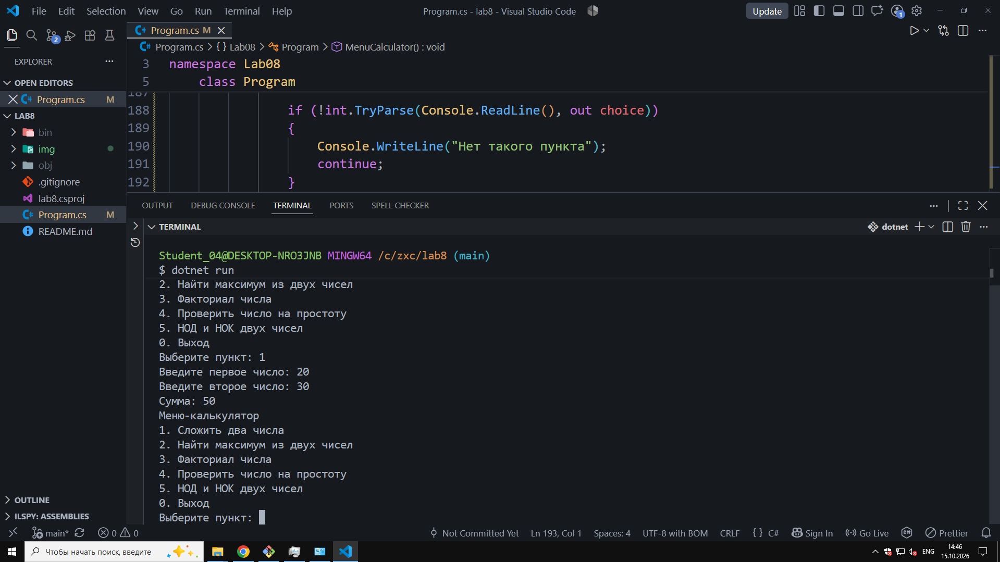
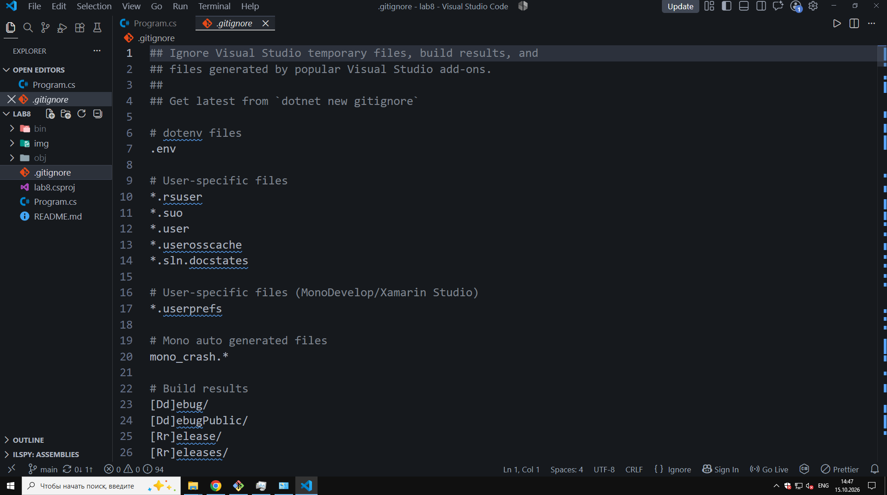

# Lab №8

**ФИО:** Чумаченко Михаил
**Группа:** ИСП-242
**Дата:** 16.10.26

## Что изучено

- Как объявлять и вызывать собственные методы, а также передавать в них данные через параметры.
- В чем отличие `void`-методов (которые выполняют действия, но ничего не возвращают) от методов с `return` (которые возвращают результат вычислений и завершают работу метода).
- Как выносить повторяющийся код в отдельные методы для упрощения поддержки, читаемости и повторного использования программы.

